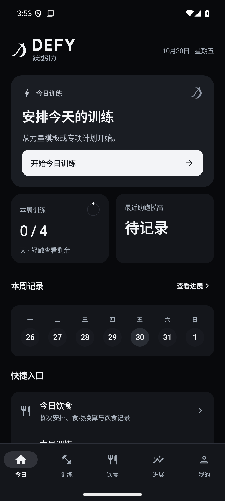
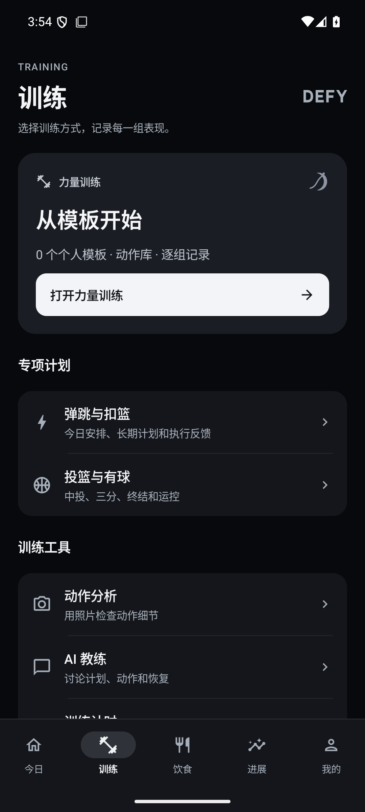

# DEFY · 跃过引力

**Beyond your limits.** A native Android training companion for strength, jumping and basketball, with local records, nutrition calculations and optional AI services.

[中文](README.md) · [Releases](https://github.com/zhengmoumou13/DEFY/releases) · [Build guide](docs/BUILDING.md) · [License](LICENSE)

 

## What it does

- Five dashboards: Today, Training, Nutrition, Progress and Profile; light/dark appearance and original vector branding.
- Offline library of **6,554 exercise text entries**, **13 starter routines**, editable templates, saved workout sessions and set-by-set logging.
- Ten families of original Canvas motion diagrams for selected exercises, plus user-owned or separately licensed video imports. Not every exercise has a demonstration.
- Daily and long-term jumping plans; compact exercise summaries, expandable coaching details, checklists and rest timing.
- Basketball shooting and ball-handling records, with optional AI session planning.
- Meal plans, actual intake records and an editable reference calculator based on a cited Tan Chengyi video.
- Offline food calculations: weight to nutrients, a nutrient target to portion size, single-nutrient equivalent replacements, multiple-food totals and custom label input. Bundled reference database: **28 USDA SR Legacy foods**.
- Optional text AI, image analysis and independent speech transcription; connection tests; GLM-ASR-2512 support.
- Local backups, attachments, tasks, notes, calendar, timers and a home-screen widget.

The UI is currently primarily Simplified Chinese. This is **not a complete openGym client**: there are no openGym accounts, server synchronization, social feeds or DEFY cloud accounts. Exercise text and routines are adapted into native Kotlin/Compose workflows.

## Build

Android 8.0+ / API 26. Build with JDK 17 or 21, SDK Platform 36 and Build Tools 36.0.0. The repository includes Gradle Wrapper 8.11.1.

```bash
git clone https://github.com/zhengmoumou13/DEFY.git
cd DEFY
# Set ANDROID_HOME or configure an untracked local.properties.
./gradlew :app:testDebugUnitTest :app:assembleDebug :app:lintDebug
```

On Windows, use `gradlew.bat`. Output: `app/build/outputs/apk/debug/app-debug.apk`. No AI key is needed to build or run unit tests. First-time builds require network access to dependency repositories.

Check each [release](https://github.com/zhengmoumou13/DEFY/releases) for its APK type, signing information and checksums. Independently built or CI-generated APKs may have different signing certificates. Export a backup before switching installation/signing sources; do not uninstall an existing installation just to bypass a signature mismatch.

## AI configuration

Open **我的 → AI 服务** (Profile → AI services).

| Service | Protocol |
| --- | --- |
| Text plans, chat and reviews | Compatible `chat/completions` |
| Photo analysis | `chat/completions` with image input support |
| Speech input | `audio/transcriptions`; a dedicated adapter for GLM-ASR-2512 |

Provide your own HTTPS endpoint, API key and model ID. Speech settings are independent and do not fall back to text credentials. The image configuration retains a legacy fallback to the text key; explicitly configure the image provider's key when using different providers. See [configuration details](docs/AI_CONFIGURATION.md).

Press and hold to record, release to transcribe, drag out to cancel. Transcribed text is appended for review rather than automatically sent to the chat model. No Android system-recognition fallback is used. Connection tests make real billable requests and cannot guarantee every capability of a provider.

## Data and limitations

- Records are stored locally; no first-party cloud backend, telemetry SDK or DEFY account is included.
- API keys are encrypted using Android Keystore and excluded from exported backups.
- Invoking an AI feature sends relevant inputs and context to the endpoint you configure. Photos and audio are sent only for the corresponding requested feature.
- Exported `.dwb` archives contain personal records and potentially attachments; they are not encrypted archives.
- Raw/cooked food entries represent separate reference foods, not cooking-yield conversion. Equal portions for one nutrient do not imply equal values for the other nutrients.
- Generated plans, photo estimates and nutrition references require user judgment and do not provide medical diagnosis.
- No iOS/web client, cloud sync, comprehensive food database or licensed Gym visual animation library is included.

See [privacy](docs/PRIVACY.md), [architecture](docs/ARCHITECTURE.md), [testing](docs/TESTING.md), [changelog](CHANGELOG.md) and [contribution guide](CONTRIBUTING.md). The initial public baseline includes 91 JVM tests and manual emulator/device checks; some Android Lint warnings remain.

## License and attribution

DEFY is distributed under **GNU AGPL v3.0**. See [LICENSE](LICENSE) and [THIRD_PARTY_NOTICES.md](THIRD_PARTY_NOTICES.md).

- Exercise text, translations and routines derive from [openGym](https://github.com/DuarteSantos8/openGym), pinned to the commit recorded in its bundled `SOURCE.txt`. Upstream notices, including the relevant MIT text attribution, are retained.
- Food references come from USDA FoodData Central SR Legacy April 2018, public domain / CC0.
- The DEFY vector mark and selected Canvas demonstrations are original project assets.
- **Gym visual's separately licensed images and animations are not included.**

Screenshots use emulator fixtures. The repository excludes device data, real API credentials, signing keys and local toolchains. Please do not attach sensitive records or credentials to public issues; see [SECURITY.md](SECURITY.md).
