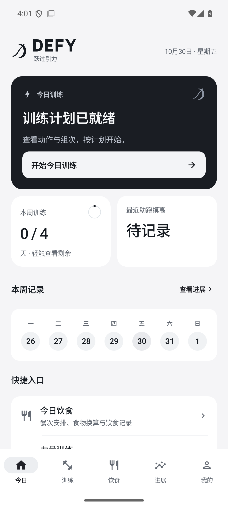
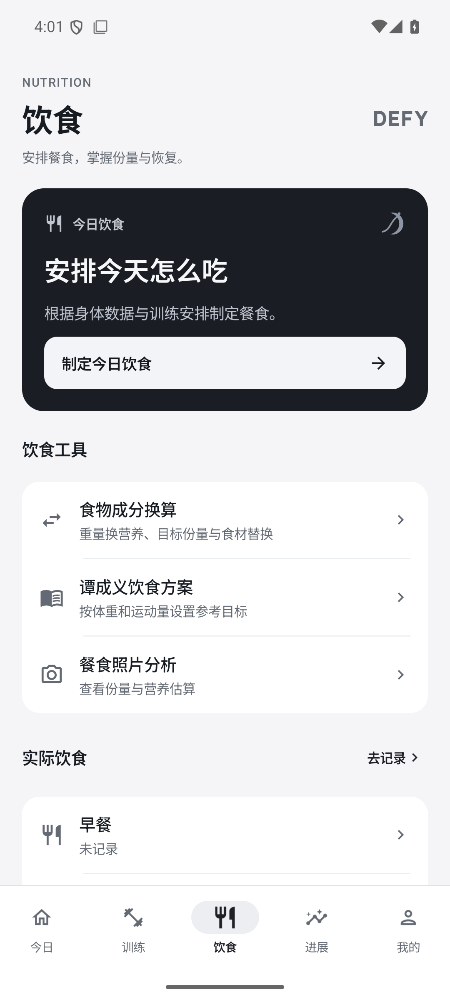
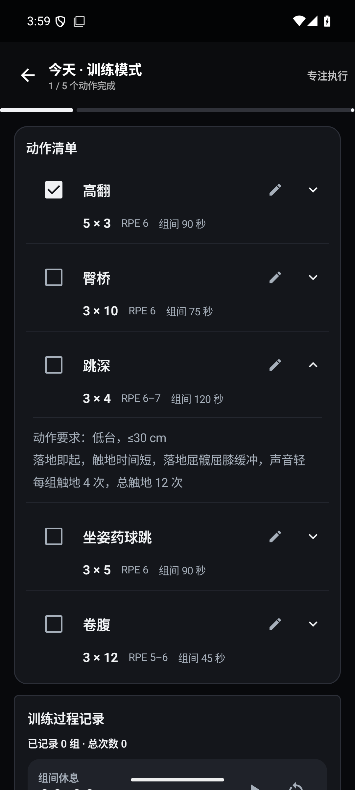

<div align="center">

# DEFY · 跃过引力

**Beyond your limits.**

面向力量、弹跳与篮球训练的原生 Android 个人训练工具。
把训练计划、逐组记录、饮食换算和 AI 辅助放进同一个日常流程。

[](https://github.com/zhengmoumou13/DEFY/actions/workflows/android.yml)
[](LICENSE)
[](docs/BUILDING.md)

[中文](README.md) · [English](README.en.md) · [使用指南](使用指南.md) · [构建指南](docs/BUILDING.md) · [发布版本](https://github.com/zhengmoumou13/DEFY/releases)

</div>

## 项目定位

DEFY 是一个以本地记录为基础、可接入自选 AI 服务的训练 App。无需注册 DEFY 账号即可使用动作库、模板、训练记录、食物换算和备份；生成计划、图片分析、语音转写需要自行配置对应服务。

当前版本为原生 Kotlin / Jetpack Compose 实现，主要界面语言为简体中文。它**不是完整 openGym 客户端**，不包含 openGym 的账号、服务器或跨设备同步；当前也没有社交动态、好友系统或自建云后台。

## 界面预览

下面均为模拟器示例画面，不含真实用户资料或 API 密钥。

<table>
  <tr><th>今日 · 浅色</th><th>今日 · 深色</th><th>训练中心</th></tr>
  <tr>
    <td></td>
    <td></td>
    <td></td>
  </tr>
  <tr><th>饮食与换算入口</th><th>训练执行与动作说明</th><th>设计方向</th></tr>
  <tr>
    <td></td>
    <td></td>
    <td>黑白明暗主题<br>当前状态与主要操作优先<br>动作与说明分层展示<br>原创矢量标志随主题变化</td>
  </tr>
</table>

## 已实现功能

| 模块 | 能力 | 是否需要网络 / AI |
| --- | --- | --- |
| 今日 | 训练入口、未结束训练续接、周目标、摸高记录、快捷入口 | 本地可用 |
| 力量训练 | 6,554 个动作文字条目，中文内容优先，部位 / 器械筛选，13 个入门模板，可编辑个人模板，逐组记录 | 本地可用 |
| 动作演示 | 10 类原创 Canvas 动态示意；播放、暂停、慢速；关联自有或获许可的视频 | 本地可用；并非所有动作都有动画 |
| 弹跳与扣篮 | 每日 / 长期 AI 计划、紧凑动作卡、完成勾选、组间休息、实际执行反馈 | 生成需要文字 AI；已保存计划可离线读 |
| 投篮与有球 | 中投、三分、罚球、终结和运控；命中 / 出手、时长、点位、动作和历史记录；AI 有球计划 | 记录本地可用；生成需要文字 AI |
| 饮食计划 | 餐次与营养摘要、可展开说明、实际饮食记录、谭成义减脂参考参数 | 参考计算本地可用；生成需要文字 AI |
| 食物成分换算 | 重量换营养、营养目标换份量、单项营养等量替换、多食材汇总、自定义包装标签 | 本地可用；内置 28 条 USDA 参考食品 |
| 图片分析 | 选图 / 系统相机、动作或餐食分析；上传前处理方向和 EXIF | 需要支持图片输入的模型 |
| 语音输入 | 按住录音、松开转写、移出取消；独立地址 / 密钥 / 模型；支持 GLM-ASR-2512 | 需要语音 API；没有系统识别回退 |
| 进展与复盘 | 训练组数、身体数据、训练历史、AI 周期复盘 | 本地统计可用；AI 复盘需联网 |
| 数据与工具 | `.dwb` 备份恢复、附件、待办、笔记、日程、计时、小组件 | 本地可用 |
| 外观与配置 | 深浅模式、主题图标、三类 AI 配置入口与连接测试 | 切换主题本地可用 |

### 计划可读性与任务提取

- 默认显示动作、组次、强度和休息；技术提示、装备限制与补充说明展开查看。
- “每组触地 4 次，总触地 12 次”这类说明附在对应动作下，不独立计为动作或待办。
- 转为任务前可预览；饮食中的可选加餐不自动变成必做任务。
- 仍可查看和复制完整原文；现有已保存计划无需重新生成。
- 解析器不能保证适配所有模型的任意格式，异常结果请在预览中核对。

## 快速开始

### 使用 App

1. Android 8.0（API 26）及以上设备。
2. 从 [Releases](https://github.com/zhengmoumou13/DEFY/releases) 查看可用安装包，或按下方步骤自行构建。每个发布页会说明 APK 类型及校验值。
3. 打开 App，填写档案或跳过引导。
4. 离线功能可直接使用；需要 AI 时，进入 **我的 → AI 服务** 分别配置并测试。
5. 先用一份模板或一项记录熟悉流程，再配置长期计划。

安装包签名必须一致才能覆盖更新。自行构建、CI 临时构建与发布 APK 的签名可能不同；不要为了安装而直接卸载已有数据，先导出备份。详见 [安装与签名](docs/BUILDING.md#安装与更新)。

### 从源码构建

需要 JDK 17 或 21、Android SDK Platform 36 / Build Tools 36.0.0。Gradle Wrapper 已包含，无需单独安装 Gradle。

```bash
git clone https://github.com/zhengmoumou13/DEFY.git
cd DEFY
# 在 Android Studio 打开，或配置 ANDROID_HOME / 本地 local.properties
./gradlew :app:testDebugUnitTest :app:assembleDebug :app:lintDebug
```

Windows 使用 `gradlew.bat`。首次构建需要联网下载依赖；不需要任何 AI 密钥。

APK：`app/build/outputs/apk/debug/app-debug.apk`。更多环境、ADB、签名、CI 和故障排查见 [构建指南](docs/BUILDING.md)。

## AI 接入

| 用途 | 配置入口 | 接口形态 |
| --- | --- | --- |
| 训练 / 饮食计划、对话、复盘 | 我的 → AI 服务 → 文字 AI | 兼容 `chat/completions` |
| 动作 / 餐食照片 | 我的 → AI 服务 → 图片分析 | 支持 `image_url` 的 `chat/completions` |
| 录音转文字 | 我的 → AI 服务 → 语音转文字 | `audio/transcriptions`；GLM-ASR 使用专用请求适配 |

语音的地址、密钥、模型均独立保存，不使用文字服务密钥兜底。图片配置存在旧版文字密钥兼容逻辑，使用不同服务商时请明确填写图片服务自己的密钥；细节见 [AI 配置](docs/AI_CONFIGURATION.md)。

API Key 不随项目提供。连接测试会真实调用服务，可能产生费用；测试成功仅证明这次测试请求通过，不代表所有模型能力或未来额度都可用。模型名称与权限以服务商账户为准。

## 数据与隐私

- 训练记录、档案和计划存储于设备本地；没有 DEFY 账号或官方云同步。
- API Key 使用 Android Keystore 加密后写入本地配置，不进入应用导出的备份。
- 主动使用 AI 功能时，相关输入、所选照片 / 录音及该功能需要的档案或历史摘要会发给你配置的服务商。
- `.dwb` 包含个人记录和可能的附件，**不是加密保险箱**。导出后应自行保管，不要上传到公开 Issue。
- 仓库不包含个人数据库、备份、真实密钥、签名私钥、手机截图或本机工具链。文档展示的是模拟器样例。

完整说明：[隐私与权限](docs/PRIVACY.md) · [安全问题](SECURITY.md)。

## 技术结构

Kotlin 2.0.21 · Jetpack Compose / Material 3 · Navigation Compose · Room · DataStore · WorkManager · OkHttp · kotlinx.serialization。

```text
app/src/main/java/com/workhub/app/
├── ai/           # 文本、图片、语音、连接测试与服务适配
├── appearance/   # 主题与桌面图标切换
├── data/         # Room 实体、DAO、迁移、Repository 与备份快照
├── gym/          # 动作库、模板、训练场次与原创演示
├── nutrition/    # 食物营养换算、饮食参考参数
├── settings/     # 配置、档案校验与密钥加密
├── ui/           # 主界面及各功能 Compose 页面
└── ...           # 文件、通知、媒体、训练辅助
app/src/main/assets/  # 固定版本的文字动作数据与食物数据
app/src/test/         # JVM 单元测试与计划文本样例
scripts/              # 数据导入与公开文件检查
```

沿用 `com.workhub.app` 包名以兼容早期版本的数据；品牌名称为 DEFY。设计与数据流详见 [架构说明](docs/ARCHITECTURE.md)。

## 质量与已知限制

首次开源基线包含 91 项 JVM 测试，覆盖计划解析、营养计算、GLM 适配、连接测试、语音配置和训练数据等。已在 API 35 模拟器检查主流程、明暗主题及 360dp / 130% 字体，在 Android 12 真机验证安装与启动。Lint 仍有待整理的警告；这些检查不代表所有设备和服务商均已认证。

当前没有 iOS / Web 客户端、账号 / 社交 / 云同步、完整食品数据库或全动作视频。生熟重是不同数据条目，不是烹调出成率换算；照片营养是估算。AI 计划和饮食参考不能替代个体化专业评估。

详见 [测试与回归](docs/TESTING.md) 和 [更新记录](CHANGELOG.md)。

## 开源许可与致谢

DEFY 源码以 **GNU Affero General Public License v3.0（AGPL-3.0）** 发布，完整条款见 [LICENSE](LICENSE)。复用的第三方内容仍保留各自许可及署名。

- [openGym](https://github.com/DuarteSantos8/openGym)：动作文字、翻译与入门模板；固定提交和通知随仓库提供。
- USDA FoodData Central：28 条 SR Legacy 食品参考数据，公共领域 / CC0。
- 原创矢量标志与 Canvas 演示随本项目源码发布。
- **不包含 Gym visual 单独授权的图片、GIF 或动画，也不授予它们的使用权。**

[第三方通知](THIRD_PARTY_NOTICES.md) · [数据来源与再生成](docs/DATA_SOURCES.md) · [谭成义方案来源](docs/tan-diet-source.md)。

欢迎通过 [Issues](https://github.com/zhengmoumou13/DEFY/issues) 提交可复现问题，通过 Pull Request 改进。开始前请阅读 [贡献指南](CONTRIBUTING.md)，避免提交真实个人数据或未经授权的素材。
