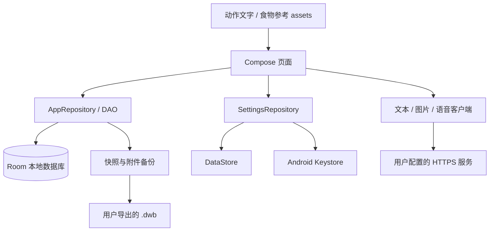

# 架构与数据流

## 当前实现

DEFY 是单 Android application 模块，使用 Kotlin、Jetpack Compose 和 Material 3。没有随仓库提供的服务端；账号、多人协作、社交和云同步不是当前功能。

`WorkHubApplication` 创建 Room 数据库与 `AppRepository`。`MainActivity` 观察主题配置，显示 `AppRoot`；后者负责主导航和功能路由。多数页面直接观察 Repository / DAO 的 Flow，并由 Compose 管理表单状态。当前并未把所有页面统一迁移到独立 ViewModel 层。

## 目录职责

| 路径（`com.workhub.app` 下） | 主要职责 |
| --- | --- |
| `ai/` | 请求构造、提示词、GLM 参数适配、连接测试、文字 / 图片 / 语音解析 |
| `appearance/` | 明暗外观持久化、互斥 Launcher aliases、启动主题 |
| `data/` | 实体、DAO、Room 迁移、Repository、序列化快照 |
| `files/` | 私有文件、导入、ZIP / JSON 备份及恢复 |
| `gym/` | 动作文字资源、模板 / 场次编码、原创示意匹配 |
| `nutrition/` | 饮食系数与食品营养纯计算逻辑 |
| `media/` | 图片处理、录音和临时媒体 |
| `notify/` | 提醒调度和通知 |
| `settings/` | 服务配置、档案校验、Keystore 加解密 |
| `training/` | 训练领域辅助逻辑 |
| `ui/dashboard/` | 五个主页面及共用视觉组件 |
| `ui/ai/` | 计划展示、执行、文本解析、任务预览与长期计划 |
| `ui/gym/` / `ui/ball/` | 力量与有球训练流程 |
| `ui/diet/` | 饮食参考和食物换算界面 |
| `ui/settings/` / `ui/media/` | 服务设置、连接测试、图片和语音输入 |

## 计划 → 展示 → 执行

原始计划文本作为来源保留。`PlanItemParser` 提取可执行项并维持稳定键；`FitnessPlanPresentation` / `DietPlanPresentation` 负责把文字映射为可读摘要，而不是重新生成内容。

动作本身与技术说明分开：统计触地次数、节奏或落地提示可以属于前一动作，但不能变成单独勾选项。训练检查状态以动作键保存；修改展示方式时不能按新的显示序号重建所有键。可选餐次不应提升为强制任务。

任务导入有预览，完整原文仍可复制。新增解析规则应带具体文本样例和对应回归测试，覆盖换行、列表、表格、Markdown 外层包装等实际格式。

## 力量训练与数据兼容

动作资产是固定版本的文字 JSON；模板和场次在本地保存。逐组记录与原有 `workout_sets` 关联，以便统计使用已有记录。新字段纳入 `AppSnapshot` 并设置兼容默认值，旧备份缺失字段时仍可读取。

当前 Room schema version 为 16。数据库升级须提供迁移，不应为图省事清空用户数据库。品牌为 DEFY，但保留历史 `com.workhub.app` applicationId、`WorkHub*` 内部类名和备份路径，是数据与安装兼容性选择。

## 服务配置边界

文字、图片、语音使用各自的配置入口。语音严格依赖自身地址 / 密钥 / 模型。图片配置仍保留历史文字密钥回退；它是已知兼容行为，应在更改时提供迁移及测试，而不是只改 UI 描述。

密钥由 `ApiKeyCipher` 处理，备份设置只含非密钥字段。测试连接不保存表单；网络调用的取消与界面生命周期必须联动。

## 备份与媒体

`.dwb` 是快照和附件组成的 ZIP，不是端到端加密容器。恢复是数据替换流程，必须先确认并可先导出当前数据；导入应限制不可信路径与文件。个人演示视频属于用户导入内容，不随源码分发。

## 当前维护方向

- 把较大的 Compose 页面逐步拆成可维护的状态与组件。
- 增加 Room 迁移、备份恢复和实际交互的自动化覆盖。
- 整理 Lint 警告并持续检查大字体、键盘、返回和无障碍。
- 扩展经过核对的数据，而不是未经验证地扩大动作 / 食品 / 模型宣传范围。

这些是维护方向，不表示已实现的功能或承诺日期。
